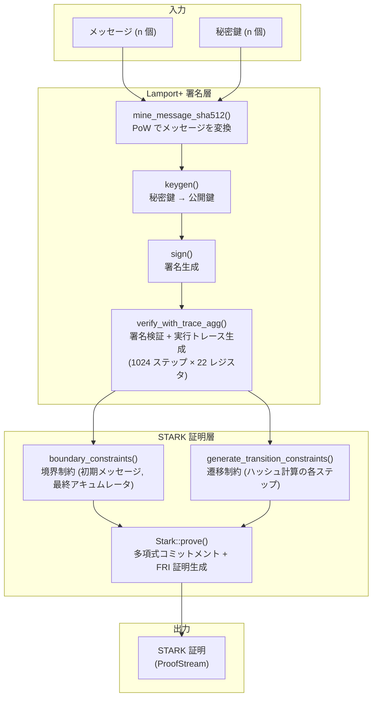
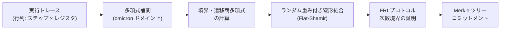
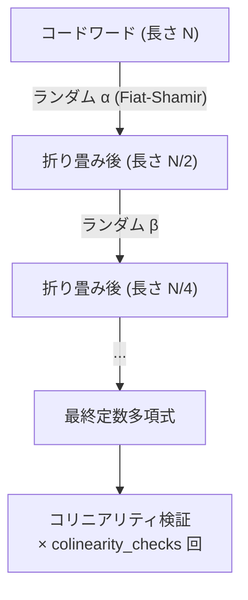
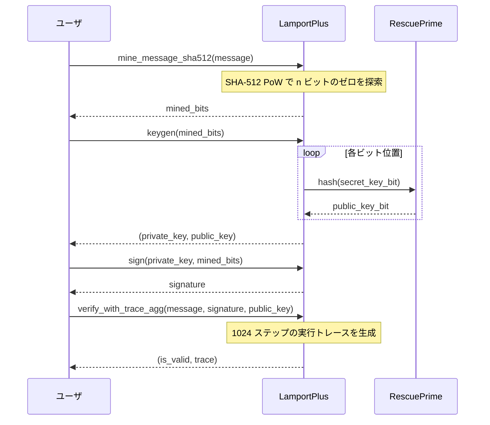

# プロジェクト概要

> 対象読者: 新規参加エンジニア向け入門ガイド

---

## 1. プロジェクトの目的と主な機能

このプロジェクトは **ハッシュベース署名とゼロ知識証明（STARK）を組み合わせた暗号ライブラリ** の実装です。

### 主な機能

| 機能 | 概要 |
|------|------|
| **Lamport+ 署名** | 一方向ハッシュ関数ベースのデジタル署名スキーム |
| **集約署名（Aggregate Signature）** | 複数の Lamport+ 署名を1つの STARK 証明にまとめる |
| **STARK 証明系** | 計算トレースに対するスケーラブルな透明性ゼロ知識証明 |
| **FRI プロトコル** | STARK 内部で使用する多項式近接テスト（Fast Reed-Solomon IOP） |
| **RescuePrime ハッシュ** | 有限体上の置換ベースハッシュ関数（zkSNARK/STARK フレンドリー） |
| **Merkle ツリー** | コミットメントスキームとして使用（RescuePrime / BLAKE3 対応） |

### ユースケースのイメージ（要確認）

複数の署名者がそれぞれ Lamport+ で署名し、検証者は各署名の正しさを個別に確認する代わりに、1つの STARK 証明を検証するだけで全員の署名の正当性を確かめられる。これにより検証コストを削減できる。

---

## 2. ディレクトリ構成と各モジュールの役割

```
hello_cargo/
├── Cargo.toml          # ワークスペースルート（バイナリ hello_cargo の依存関係）
├── Cargo.lock
├── src/
│   └── main.rs         # 動作確認用バイナリ（現在は u128 ↔ 2進数変換のデモのみ）
└── mylib/              # 暗号ライブラリ本体
    ├── Cargo.toml
    └── src/
        ├── lib.rs              # モジュール公開の起点
        ├── modulus.rs          # 有限体演算（Field, FieldElement）
        ├── polynomial.rs       # 一変数多項式（FFT 補間含む）
        ├── mpolynomial.rs      # 多変数多項式（STARK 遷移制約の定義に使用）
        ├── rescue_prime.rs     # RescuePrime ハッシュ関数 + AIR 制約生成
        ├── merkle.rs           # Merkle ツリー（RescuePrime / BLAKE3 両対応）
        ├── fri.rs              # FRI プロトコル実装
        ├── stark.rs            # STARK 証明・検証エンジン
        ├── lamport_plus.rs     # Lamport+ 署名スキーム
        ├── agg_sig.rs          # 集約署名（複数 Lamport+ → 1 STARK 証明）
        ├── proofstream.rs      # 証明のシリアライズ + Fiat-Shamir 変換
        ├── anemoi_hash.rs      # Anemoi ハッシュ（実験的・未統合）
        └── arion_hash.rs       # Arion ハッシュ（実験的・lib.rs でコメントアウト中）
```

### 各モジュールの詳細

#### 基盤層：有限体と多項式

| ファイル | 主要な型 | 役割 |
|---------|---------|------|
| `modulus.rs` | `Field`, `FieldElement` | 素体 `p = 2¹²⁸ - 45·2⁴⁰ + 1` 上の四則演算・冪乗・原始根生成 |
| `polynomial.rs` | `Polynomial` | 係数ベクタで表現した多項式。評価・補間・FFT・商算を提供 |
| `mpolynomial.rs` | `MPolynomial` | `HashMap` で表現した多変数多項式。STARK の遷移制約記述に使用 |

#### 暗号プリミティブ層

| ファイル | 主要な型 | 役割 |
|---------|---------|------|
| `rescue_prime.rs` | `RescuePrime` | 状態サイズ 6、ラウンド数 7 の置換ベースハッシュ。トレース付きハッシュも提供 |
| `merkle.rs` | `Merkle` | Merkle ツリーの生成・パス開示・検証。コミットメントに利用 |
| `proofstream.rs` | `ProofStream` | `bincode` でシリアライズした証明オブジェクトの管理 + BLAKE3 Fiat-Shamir |

#### 証明系層

| ファイル | 主要な型 | 役割 |
|---------|---------|------|
| `fri.rs` | `Fri` | FRI 折り畳み・クエリ・多項式次数境界証明 |
| `stark.rs` | `Stark` | 境界制約・遷移制約の組み立て、FRI を使った証明・検証 |

#### アプリケーション層

| ファイル | 主要な型 | 役割 |
|---------|---------|------|
| `lamport_plus.rs` | `LamportPlus` | 鍵生成・署名・検証。検証時に実行トレースを出力 |
| `agg_sig.rs` | `AggSig` | 複数署名者のトレースを結合し STARK 証明を生成・検証 |

---

## 3. 主要な処理の流れ

### 3-1. 集約署名の生成フロー



### 3-2. STARK 証明の内部フロー



### 3-3. FRI の折り畳みフロー



### 3-4. 鍵生成と署名の流れ（Lamport+）



---

## 4. セットアップ方法と実行方法

### 前提条件

- Rust toolchain (stable) — [rustup.rs](https://rustup.rs) でインストール
- 推奨 Rust バージョン: **要確認**（`rust-toolchain.toml` または `Cargo.toml` に記載がないため）

```bash
# Rust のバージョン確認
rustup show
```

### ビルド

```bash
# プロジェクトルートから
cd /path/to/hello_cargo

# ライブラリ + バイナリをまとめてビルド
cargo build

# リリースビルド（最適化あり、暗号計算には推奨）
cargo build --release
```

### テスト実行

```bash
# mylib のテストをすべて実行
cargo test -p mylib

# 特定テストのみ実行（例: 集約署名テスト）
cargo test -p mylib test_agg_sig -- --nocapture

# バイナリ側のテスト
cargo test -p hello_cargo
```

> **注意**: STARK / 集約署名のテストは計算量が大きく、完了まで数分かかる場合があります。

### バイナリの実行

```bash
cargo run
# → 現状は u128 の 2進数変換デモのみ動作
```

### よく使うテスト対象（要確認）

```bash
# FRI プロトコルテスト
cargo test -p mylib test_fri

# Lamport+ 署名テスト
cargo test -p mylib test_lamport

# Merkle ツリーテスト
cargo test -p mylib test_merkle
```

---

## 5. 技術スタック

### 言語・ランタイム

| 技術 | バージョン | 用途 |
|------|-----------|------|
| **Rust** | stable（要確認） | 実装言語全般 |

### 主要クレート（mylib）

| クレート | バージョン | 用途 |
|---------|-----------|------|
| `ark-ff` | 0.5.0 | 有限体演算（Arkworks エコシステム） |
| `ark-poly` | 0.5.0 | 多項式演算（Arkworks） |
| `blake3` | 1.5.4 | 高速ハッシュ関数（Fiat-Shamir・Merkle ツリー） |
| `sha2` | 0.10.8 | SHA-256 / SHA-512（PoW・鍵生成） |
| `sha3` | 0.10.8 | SHA-3 ハッシュ |
| `hmac` | 0.12.1 | HMAC 認証コード |
| `ring` | 0.17.8 | 暗号操作（鍵生成・署名サポート）（要確認・実際の使用箇所を要確認） |
| `num-bigint` | 0.4 | 多倍長整数演算 |
| `num-traits` / `num-integer` | 0.2 / 0.1.46 | 数値トレイト・整数ユーティリティ |
| `rand` | 0.8.3 | 乱数生成 |
| `serde` | 1.0.214 | シリアライズフレームワーク（derive マクロ） |
| `bincode` | 1.3.3 | バイナリシリアライズ（ProofStream） |

### 暗号学的コンセプト

| コンセプト | 実装箇所 |
|-----------|---------|
| 素体 `p = 2¹²⁸ - 45·2⁴⁰ + 1` | `modulus.rs` |
| NTT (Number Theoretic Transform) | `polynomial.rs` (`fft_in_place`) |
| Fiat-Shamir ヒューリスティック | `proofstream.rs` (`prover_fiat_shamir`) |
| AIR (Algebraic Intermediate Representation) | `rescue_prime.rs`, `agg_sig.rs` |
| PoW (Proof of Work) | `lamport_plus.rs` (`mine_message_sha512`) |

---

## 6. 参考情報・関連リンク（要確認）

以下の論文・リソースが実装の参考になっています（要確認）:

- **RescuePrime**: _Rescue-Prime: a Standard Specification_ (Ashur & Dhooghe, 2020)
- **STARK**: _Scalable, transparent, and post-quantum secure computational integrity_ (Ben-Sasson et al., 2018)
- **FRI**: _Fast Reed-Solomon Interactive Oracle Proofs of Proximity_ (Ben-Sasson et al., 2018)
- **Lamport signatures**: _A new one-way function for digital signatures_ (Lamport, 1979)
- **Arkworks**: https://github.com/arkworks-rs

---

## 7. 未実装・作業中の機能

| モジュール | 状態 |
|-----------|------|
| `anemoi_hash.rs` | 実装中・テストあり・未統合 |
| `arion_hash.rs` | 実装済み・`lib.rs` でコメントアウト中 |
| `threshold_sig.rs` | 参照あり・`lib.rs` でコメントアウト中 |

---

> このドキュメントは 2026-11-13 時点のコードを元に作成しました。
> 「要確認」と記載した箇所は推測または未確認情報です。Pull Request や Issue での修正歓迎します。
